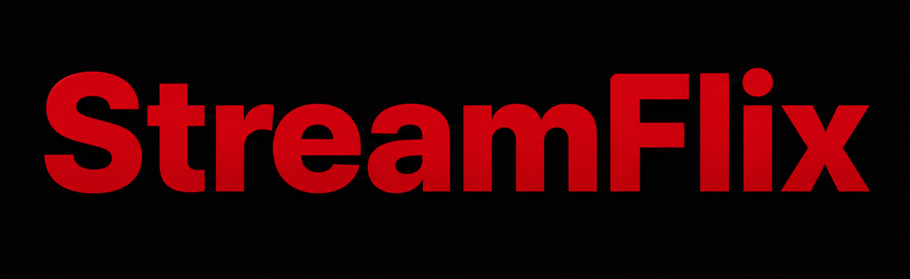

# StreamFlix

<br/>
<div align="center">
<a href="https://github.com/onlyvaibhav/StreamFlix.git">
<!-- You can add a logo image here in the future -->

</a>

<h3 align="center">StreamFlix</h3>
<h4 align="center"><a href="https://streamflix-a0l5.onrender.com/">🔴 View Live Web Project</a></h4>

  <p align="center">
    A fully-featured, Netflix-like streaming platform that uses Telegram as a highly scalable backend storage server.
    <br/>
    <br/>
    <a href="#features"><strong>Explore the features »</strong></a>
    <br/>
    <br/>
    <a href="#getting-started">Getting Started</a>
    ·
    <a href="#tech-stack">Tech Stack</a>
    ·
    <a href="#configuration">Configuration</a>
  </p>
</div>

---

## 🚀 About The Project

StreamFlix is a self-hosted streaming video platform delivering a premium, minimalist, Netflix-like user experience. It provides **two** fully-featured frontend clients (a Vanilla Web SPA and a cross-platform Flutter App) paired with an advanced Express.js backend designed to leverage the unlimited storage capabilities of Telegram. By utilizing Telegram channels as a content delivery network (CDN) and storage backend, StreamFlix bypasses traditional hosting limitations.

It gracefully handles everything from on-the-fly video remuxing and DASH streaming to automatic TMDB metadata fetching, multi-track subtitle syncing, and robust stream auto-recovery for the ultimate resilient streaming experience.

---

## ✨ Features

### 🎬 Universal Features (Web & App)
- **Netflix-like UI:** A beautiful, highly responsive, and dynamic frontend featuring smooth animations, carousels, and grid layouts.
- **Telegram Video Streaming:** Streams media formats on-the-fly directly from Telegram channels. No need to download the full file before playing.
- **Library browsing:** Seamlessly browse categorized content (Movies, TV Shows) and perform search queries.
- **Multi‑audio & subtitles:** Dynamically switch between multiple embedded audio tracks, subtitles and load external subtitles.
- **Support Unsupported Audio like EAC3:** Transcodes EAC3 to AAC on-the-fly.
- **Next episode auto navigation:** Seamlessly jump to the next episode in a TV series.
- **Smart Playback:** Resume playback from where you left off, with automatic grouping of multi-part split movies.

### 🌐 Web Client (`public/`)
- **Vanilla DOM-Driven Rendering:** No heavy JavaScript frameworks (like React or Vue). The UI is dynamically assembled and injected into the DOM for blazing fast performance.
- **Custom Player Overlay:** A sophisticated HTML5 video player overlay featuring play/pause, seek, volume, speed controls, fullscreen, and keyboard shortcuts (Space, K, F, M, Arrows).
- **DASH Processing:** Integrated adaptive streaming using `dash.js`.

### 📱 Flutter App (`streamflix/`)
- **Cross-Platform:** Write once, run on Android, iOS, Windows, macOS, Linux, and Web.
- **Bulletproof Streaming Engine:** Smart 3-strike auto-retry system gracefully handles Telegram DC migrations and expired file references behind the scenes without interrupting your video.
- **Background Suspension Recovery:** Intelligently intercepts fake EOF states caused by minimizing the app, seamlessly restoring your stream from your exact last known position when you resume.
- **Stateless Subtitles & Error Handling:** External subtitles are fetched via stateless base64url payloads. Non-fatal errors (like a corrupted subtitle file) show a non-intrusive toast instead of crashing the video.
- **Advanced Player:** A sophisticated `media_kit` powered video player featuring hardware decoding fallback mechanisms.

---

## 🏗 Architecture

The project consists of a detached Node.js backend acting as a proxy/CDN, serving data to two distinct frontends:

- **Backend (Express.js):** Acts as a bridge between the Telegram MTProto API (via GramJS) and standard HTTP requests. It proxies byte ranges, extracts metadata, fetches subtitles, and caches chunks in memory.
- **Frontend (Web Client):** Built as a Single Page Application (SPA) utilizing vanilla web technologies and the browser History API for routing.
- **Frontend (Flutter App):** Built entirely with Flutter, enabling high-performance rendering. Utilizes `flutter_riverpod` for responsive, decoupled state management, and `media_kit` (FFmpeg-based) for near-native video performance.

---

## 🛠 Tech Stack

**Frontend (Web Client)**
* Vanilla HTML5 & CSS3
* Vanilla JavaScript (ES6+)
* HTML5 Video & `dash.js`

**Frontend (Flutter App)**
* [Flutter](https://flutter.dev/) & Dart
* `flutter_riverpod` (State Management)
* `media_kit` (Advanced FFmpeg-based Video Player)
* `go_router` (Routing)

**Backend (Node.js)**
* [Node.js](https://nodejs.org/) & [Express.js](https://expressjs.com/)
* [MTProto (gramjs)](https://github.com/gram-js/gramjs) for interacting natively with the Telegram API
* [FFmpeg](https://ffmpeg.org/) for media processing, adaptive streaming, and on-the-fly remuxing
* Memory LRU-Cache for chunk optimization

---

## 🔌 API Overview

StreamFlix is designed with a detached backend that adheres to the following REST API contracts:

- `/api/metadata` (or fallback `/api/movies/library`) - Provides the initial library data including movies, TV shows, hero items, and genre-based rows.
- `/api/search?q=...` - Returns library items matching the search query.
- `/api/metadata/:fileId` - Fetches detailed information for a specific movie.
- `/api/tv/:tmdbId` - Fetches detailed data for a specific TV show, including seasons and episodes.
- `/api/stream/:fileId` - The main media stream endpoint for playback.
- `/api/stream/:fileId/tracks` - Returns available audio and subtitle tracks, stream duration, and flags.
- `/api/stream/:fileId/subtitle/:streamIndex` - Serves embedded subtitles for the specified stream index.
- `/api/subtitles/movie/:fileId` - Lists available external subtitle options.
- `/api/subtitles/file/:subtitleId` - Fetches the raw text (SRT/VTT) of an external subtitle.
- `/api/stream/:fileId/heartbeat` - Pinged during active playback to notify the server that the stream session is alive.

---

## 🏁 Getting Started

To get a local copy up and running, follow these simple steps.

### Prerequisites

1. **Telegram API Credentials**
   * Go to [my.telegram.org](https://my.telegram.org)
   * Create an application and note your `api_id` and `api_hash`.
2. **Telegram Bot** *(Recommended)*
   * Talk to [@BotFather](https://t.me/BotFather) on Telegram and create a new bot to get a token.
   * Add this bot to your private channel as an admin.
3. **Private Channel**
   * Create a private Telegram channel and upload your movies/shows as video files.
   * Note the channel ID (format: `-100XXXXXXXXXX`).
4. **System Requirements**
   * `Node.js >= 18.0.0`
   * `FFmpeg` installed on your host machine
   * `Flutter SDK` (for building the app)

### Installation

#### 1. Setup the Backend
1. **Clone the repository:**
   ```bash
   git clone https://github.com/vaibhav-btc/Telegram_Streaming.git
   cd StreamFlix
   ```
2. **Install dependencies:**
   ```bash
   npm install
   ```
3. **Configure Environment:** 
   Duplicate `.env.example` to `.env` and fill in your details (API IDs, TMDB keys, etc.).
   ```bash
   cp .env.example .env
   ```
4. **Start the backend server:**
   ```bash
   npm run dev
   ```

#### 2. Run the Web Client
1. Open a new terminal.
2. Serve the `public/` directory via any static file server:
   ```bash
   npx serve public/
   ```
3. Navigate to `http://localhost:3000` (or whichever port your static server specifies).

#### 3. Run the Flutter App
1. Open a new terminal.
2. Navigate to the `streamflix` directory and run the app:
   ```bash
   cd streamflix
   flutter pub get
   flutter run -d chrome  # or run on Android/iOS/Windows
   ```

*(Alternatively, you can run the entire backend via Docker Compose using `docker-compose up --build -d`)*

---

## ⚙️ Configuration

The application is highly configurable via the `.env` file located in the root directory.

| Variable | Description | Example |
| -------- | ----------- | ------- |
| `TELEGRAM_API_ID` | Your Telegram API ID | `1234567` |
| `TELEGRAM_API_HASH` | Your Telegram API Hash | `abc123def456...` |
| `TELEGRAM_SESSION_STRING` | Base64 Session string | `1BQA...` |
| `TELEGRAM_CHANNEL_ID` | Target Telegram channel | `-1001752608946` |
| `TELEGRAM_BOT_TOKEN` | Your BotFather token | `123:ABC...` |
| `TMDB_API_KEY` | TMDB API Key for metadata | `d5f8...` |
| `MAX_CACHE_SIZE` | Memory size limit for chunks | `104857600` |

---

## 📁 Project Structure

- `backend/` *(Root directory)* - Contains the Express.js server, GramJS MTProto proxy, FFmpeg transcoders, and memory LRU caches.
- `public/` - The Web Client SPA. Contains `index.html`, `app.js`, styles, and static assets.
- `streamflix/` - The Flutter App source code. `lib/` contains screens, providers (`riverpod`), and the `media_kit` video player.
- `controllers/` & `routes/` - Node.js API route handlers for stream logic, metadata fetching, and subtitle extraction.

---

## ⚠️ Known Issues / Limitations

- **Remuxing Limitations:** If the backend utilizes FFmpeg remuxing on-the-fly to handle incompatible native codecs, seeking may introduce momentary audio/video sync offsets tied to keyframe precision.
- **Unsupported Audio:** Some original audio codecs (e.g., EAAC or specific DTS builds) may lack native browser support. The system monitors a `hasUnsupportedAudio` flag from the tracks endpoint to react if transcoding is unavoidable.
- **Autoplay Restrictions (Web):** Browsers aggressively restrict autoplaying videos with sound. The custom player adheres to requiring human interaction to initialize un-muted playback.
- **Subtitle Desync:** If Audio switches from default to non-default, you might experience subtitle desync. Use Quick Sync features in the player to re-align them.

---

## ⚠️ Disclaimer

This project is for educational and personal use only. Streaming copyrighted content without permission is illegal. The maintainers of this repository are not responsible for how this software is used.

---

## 🤝 Contributing

Contributions are welcome! If you plan to introduce new components, please adhere to:
- Keeping dependencies zero for the Web Client frontend (no React/Vue/Svelte).
- Using Flutter Best Practices for the App frontend.

1. Fork the Project.
2. Create your Feature Branch (`git checkout -b feature/AmazingFeature`).
3. Commit your changes (`git commit -m 'Add some AmazingFeature'`).
4. Push to the Branch (`git push origin feature/AmazingFeature`).
5. Open a Pull Request.

---

## 📄 License

Distributed under the MIT License. See `LICENSE` for more information.

<br>
<div align="center">
  <i>Built with ❤️ by Vaibhav</i>
</div>
